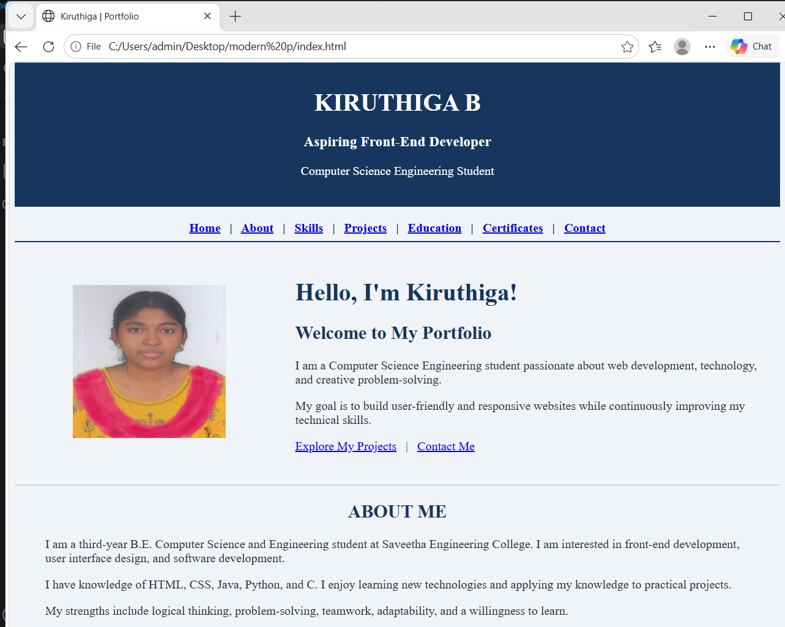
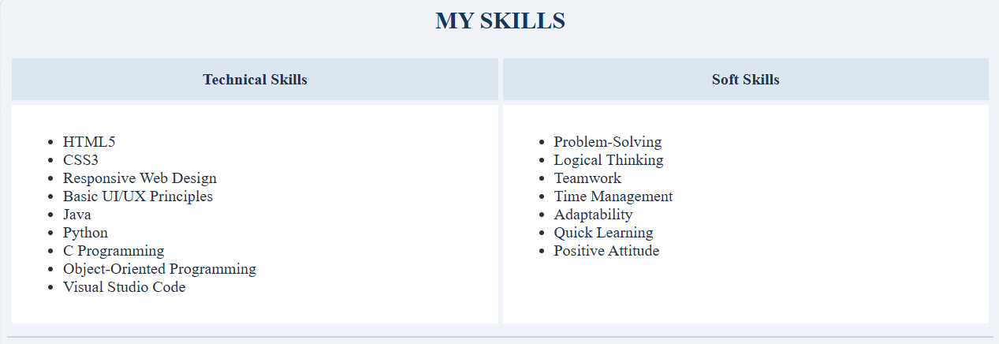
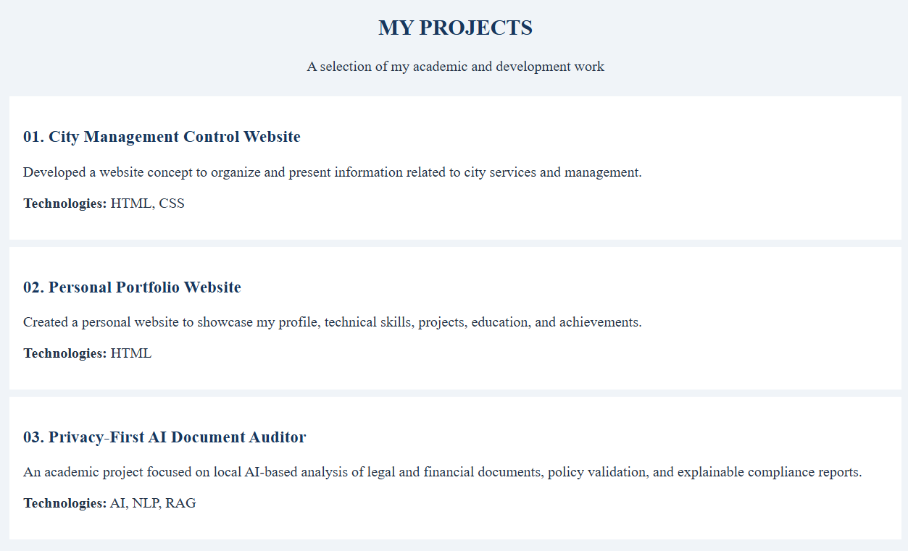
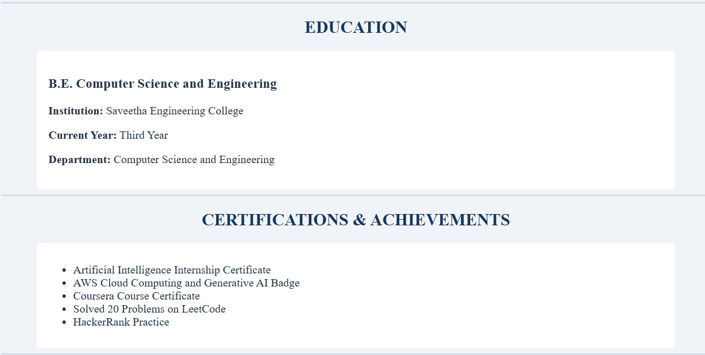
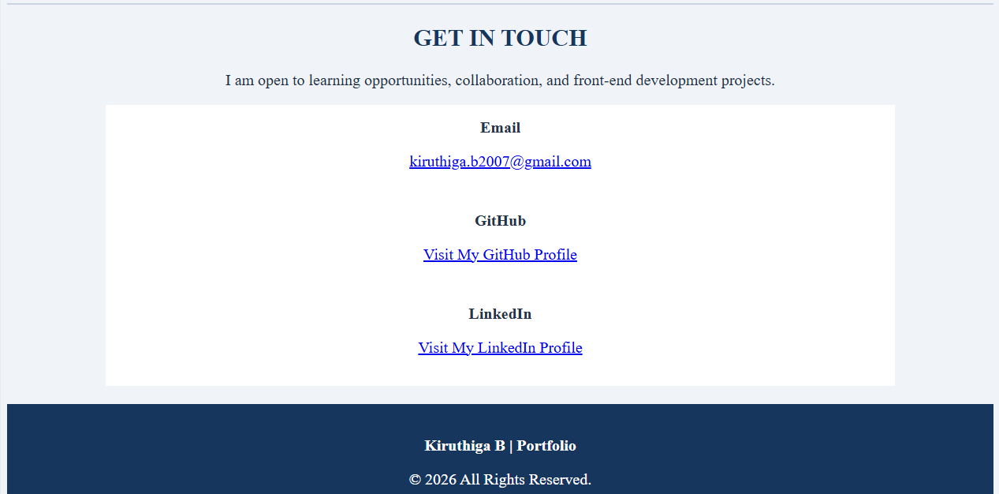

# Ex01 Portfolio

## Date: 29.10.2026

## AIM
To create a Portfolio using HTML and CSS.

## ALGORITHM
### STEP 1
Create an HTML file (index.html)

### STEP 2
Create a CSS file (style.css)

### STEP 3
Include a navigation bar with links to different sections.

### STEP 4
Add structured sections for introduction, about, projects, and contact details.

### STEP 5
Define global styles for fonts, colors, and layout.

### STEP 6
Style the header, navigation bar, and sections.

### STEP 7
Use Flexbox or CSS Grid for layout design.

### STEP 8
Add hover effects and transitions for interactivity.

### STEP 9
Add Images and Media.

### STEP 10
Use optimized images for a professional look.

### STEP 11
Open the HTML file in a browser to check layout and functionality.

### STEP 12
Fix styling issues and refine content placement.

### STEP 13
Deploy the Portfolio.

### STEP 14
Upload to GitHub Pages for free hosting.

## PROGRAM

```

<!DOCTYPE html>
<html lang="en">
<head>
    <meta charset="UTF-8">
    <meta name="viewport" content="width=device-width, initial-scale=1.0">
    <title>Kiruthiga | Portfolio</title>
</head>

<body bgcolor="#F0F4F8" text="#243247">

    <!-- Header -->
    <header>
        <center>
            <table width="100%" bgcolor="#17365D" cellpadding="20">
                <tr>
                    <td align="center">
                        <font color="white">
                            <h1>KIRUTHIGA B</h1>
                            <h3>Aspiring Front-End Developer</h3>
                            <p>Computer Science Engineering Student</p>
                        </font>
                    </td>
                </tr>
            </table>

            <br>

            <nav>
                <font color="#17365D">
                    <b>
                        <a href="#home">Home</a> &nbsp; | &nbsp;
                        <a href="#about">About</a> &nbsp; | &nbsp;
                        <a href="#skills">Skills</a> &nbsp; | &nbsp;
                        <a href="#projects">Projects</a> &nbsp; | &nbsp;
                        <a href="#education">Education</a> &nbsp; | &nbsp;
                        <a href="#certifications">Certificates</a> &nbsp; | &nbsp;
                        <a href="#contact">Contact</a>
                    </b>
                </font>
            </nav>
        </center>

        <hr color="#17365D">
    </header>

    <main>

        <!-- Home Section -->
        <section id="home">
            <table width="100%" cellpadding="15">
                <tr>
                    <td width="35%" align="center">
                        
                    </td>

                    <td width="65%">
                        <font color="#17365D">
                            <h1>Hello, I'm Kiruthiga!</h1>
                            <h2>Welcome to My Portfolio</h2>
                        </font>

                        <p>
                            I am a Computer Science Engineering student
                            passionate about web development, technology,
                            and creative problem-solving.
                        </p>

                        <p>
                            My goal is to build user-friendly and
                            responsive websites while continuously
                            improving my technical skills.
                        </p>

                        <p>
                            <a href="#projects">Explore My Projects</a>
                            &nbsp; | &nbsp;
                            <a href="#contact">Contact Me</a>
                        </p>
                    </td>
                </tr>
            </table>
        </section>

        <hr color="#CBD5E1">

        <!-- About Section -->
        <section id="about">
            <center>
                <font color="#17365D">
                    <h2>ABOUT ME</h2>
                </font>
            </center>

            <blockquote>
                <p>
                    I am a third-year B.E. Computer Science and
                    Engineering student at Saveetha Engineering College.
                    I am interested in front-end development, user
                    interface design, and software development.
                </p>

                <p>
                    I have knowledge of HTML, CSS, Java, Python, and C.
                    I enjoy learning new technologies and applying my
                    knowledge to practical projects.
                </p>

                <p>
                    My strengths include logical thinking,
                    problem-solving, teamwork, adaptability, and
                    a willingness to learn.
                </p>
            </blockquote>
        </section>

        <hr color="#CBD5E1">

        <!-- Skills Section -->
        <section id="skills">
            <center>
                <font color="#17365D">
                    <h2>MY SKILLS</h2>
                </font>
            </center>

            <table width="100%" cellpadding="12" cellspacing="5">
                <tr bgcolor="#DCE6F1">
                    <th width="50%">Technical Skills</th>
                    <th width="50%">Soft Skills</th>
                </tr>

                <tr bgcolor="white">
                    <td valign="top">
                        <ul>
                            <li>HTML5</li>
                            <li>CSS3</li>
                            <li>Responsive Web Design</li>
                            <li>Basic UI/UX Principles</li>
                            <li>Java</li>
                            <li>Python</li>
                            <li>C Programming</li>
                            <li>Object-Oriented Programming</li>
                            <li>Visual Studio Code</li>
                        </ul>
                    </td>

                    <td valign="top">
                        <ul>
                            <li>Problem-Solving</li>
                            <li>Logical Thinking</li>
                            <li>Teamwork</li>
                            <li>Time Management</li>
                            <li>Adaptability</li>
                            <li>Quick Learning</li>
                            <li>Positive Attitude</li>
                        </ul>
                    </td>
                </tr>
            </table>
        </section>

        <hr color="#CBD5E1">

        <!-- Projects Section -->
        <section id="projects">
            <center>
                <font color="#17365D">
                    <h2>MY PROJECTS</h2>
                </font>
                <p>A selection of my academic and development work</p>
            </center>

            <table width="100%" cellpadding="15" cellspacing="8">

                <tr bgcolor="#FFFFFF">
                    <td>
                        <font color="#17365D">
                            <h3>01. City Management Control Website</h3>
                        </font>

                        <p>
                            Developed a website concept to organize and
                            present information related to city services
                            and management.
                        </p>

                        <p><b>Technologies:</b> HTML, CSS</p>
                    </td>
                </tr>

                <tr bgcolor="#FFFFFF">
                    <td>
                        <font color="#17365D">
                            <h3>02. Personal Portfolio Website</h3>
                        </font>

                        <p>
                            Created a personal website to showcase my
                            profile, technical skills, projects,
                            education, and achievements.
                        </p>

                        <p><b>Technologies:</b> HTML</p>
                    </td>
                </tr>

                <tr bgcolor="#FFFFFF">
                    <td>
                        <font color="#17365D">
                            <h3>03. Privacy-First AI Document Auditor</h3>
                        </font>

                        <p>
                            An academic project focused on local AI-based
                            analysis of legal and financial documents,
                            policy validation, and explainable compliance
                            reports.
                        </p>

                        <p><b>Technologies:</b> AI, NLP, RAG</p>
                    </td>
                </tr>

            </table>
        </section>

        <hr color="#CBD5E1">

        <!-- Education Section -->
        <section id="education">
            <center>
                <font color="#17365D">
                    <h2>EDUCATION</h2>
                </font>
            </center>

            <table width="90%" align="center" cellpadding="15"
                   bgcolor="white">
                <tr>
                    <td>
                        <h3>B.E. Computer Science and Engineering</h3>
                        <p><b>Institution:</b> Saveetha Engineering College</p>
                        <p><b>Current Year:</b> Third Year</p>
                        <p><b>Department:</b> Computer Science and Engineering</p>
                    </td>
                </tr>
            </table>
        </section>

        <hr color="#CBD5E1">

        <!-- Certifications Section -->
        <section id="certifications">
            <center>
                <font color="#17365D">
                    <h2>CERTIFICATIONS & ACHIEVEMENTS</h2>
                </font>
            </center>

            <table width="90%" align="center" cellpadding="10"
                   bgcolor="white">
                <tr>
                    <td>
                        <ul>
                            <li>Artificial Intelligence Internship Certificate</li>
                            <li>AWS Cloud Computing and Generative AI Badge</li>
                            <li>Coursera Course Certificate</li>
                            <li>Solved 20 Problems on LeetCode</li>
                            <li>HackerRank Practice</li>
                        </ul>
                    </td>
                </tr>
            </table>
        </section>

        <hr color="#CBD5E1">

        <!-- Contact Section -->
        <section id="contact">
            <center>
                <font color="#17365D">
                    <h2>GET IN TOUCH</h2>
                </font>

                <p>
                    I am open to learning opportunities,
                    collaboration, and front-end development projects.
                </p>
            </center>

            <table width="80%" align="center" cellpadding="12"
                   bgcolor="white">
                <tr>
                    <td align="center">
                        <b>Email</b>
                        <p>
                            <a href="mailto:kiruthiga.b2007@gmail.com">
                                kiruthiga.b2007@gmail.com
                            </a>
                        </p>
                    </td>
                </tr>

                <tr>
                    <td align="center">
                        <b>GitHub</b>
                        <p>
                            <a href="https://github.com/Kiruthiga216"
                               target="_blank">
                                Visit My GitHub Profile
                            </a>
                        </p>
                    </td>
                </tr>

                <tr>
                    <td align="center">
                        <b>LinkedIn</b>
                        <p>
                            <a href="https://www.linkedin.com/in/kiruthiga-b-6b074532a"
                               target="_blank">
                                Visit My LinkedIn Profile
                            </a>
                        </p>
                    </td>
                </tr>
            </table>
        </section>

    </main>

    <br>

    <!-- Footer -->
    <footer>
        <table width="100%" bgcolor="#17365D" cellpadding="15">
            <tr>
                <td align="center">
                    <font color="white">
                        <p>
                            <b>Kiruthiga B | Portfolio</b>
                        </p>
                        <p>
                            &copy; 2026 All Rights Reserved.
                        </p>
                        <p>Built using HTML only.</p>
                    </font>
                </td>
            </tr>
        </table>
    </footer>

</body>
</html>

```


## OUTPUT











## RESULT
The program for creating Portfolio using HTML and CSS is executed successfully.
